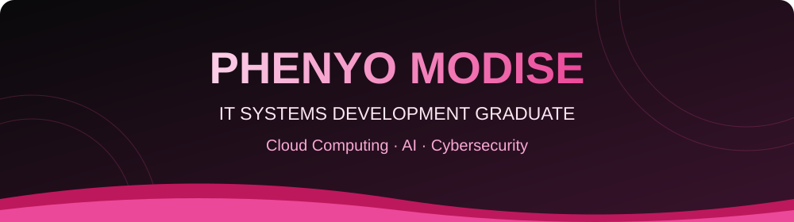

**Open to entry-level IT, cloud and junior developer roles, internships and learnerships.**

## 🌸 About Me

I'm an IT Systems Development graduate from Boston City Campus, graduating **Magna Cum Laude**. My interests include cloud computing, artificial intelligence, cybersecurity and software development. I enjoy solving problems, debugging systems and learning how technology can deliver practical solutions.

- Based in Kempton Park, Gauteng, South Africa.
- Hands-on experience with AWS cloud infrastructure and conversational AI.
- AWS re/Start capstone team lead, coordinating a four-person development team.
- Committed to continuous learning and building practical technical skills.

## 🎓 Education

| Qualification | Institution | Period |
|---|---|---|
| Diploma in IT Systems Development (NQF Level 6) | Boston City Campus, Kempton Park | 2023–2025 |
| National Senior Certificate | Norkem Park High School | 2022 |

**Academic achievement:** Magna Cum Laude — 16 of 21 modules at distinction (75%+).

Selected distinction modules: Systems Development 3, Software Testing 3, Database Programming 2 and Ethical Hacking (Praxis).

## 🎀 Certifications & Learning Credentials

| Credential | Issuer / programme |
|---|---|
|  **AWS Certified Cloud Practitioner** | Amazon Web Services · AWS re/Start |
|  **Azure Fundamentals (AZ-900)** | Microsoft · Mecer Inter-Ed |
|  **Azure AI Fundamentals (AI-901)** | Microsoft · Mecer Inter-Ed |
| Introduction to Cybersecurity | Cisco |
| Cybersecurity Job Simulation | Mastercard / Forage |
| Introduction to Coding | SheCodes |

## 💻 Technical Skills

### Cloud & Artificial Intelligence

   

| Area | Skills |
|---|---|
| AWS | EC2, S3, IAM, RDS, Lambda, VPC, VPN, CloudWatch, Step Functions, SQS, Amazon Lex |
| Azure | Core cloud services, governance, AI and machine learning fundamentals |
| Systems development | Systems analysis and design, software testing, database programming, project and workflow management |
| Cybersecurity | Security fundamentals, ethical hacking concepts, access management |
| Programming | Foundational Python, introductory coding |
| Professional | Debugging, problem-solving, communication, Microsoft Office, time management |

## 🚀 Featured Projects

### S3QuizBot — Conversational Quiz Chatbot
**AWS re/Start capstone · 2026 · Team Lead**

Led a four-person team to develop a quiz chatbot using Amazon Lex, IAM and S3, enabling students to practise independently. Designed conversational flows and intents, configured permissions, coordinated testing and presented the working demo to the client.

### AWS Cloud Infrastructure Labs
**AWS re/Start · 2026**

Provisioned compute, storage, networking and database resources, and configured security and monitoring using IAM and CloudWatch.

[Explore my AWS re/Start portfolio →](https://github.com/PhenyoModise/AWS-Re-Start-Portfolio)

### Data Annotation & QA Validation
**Self-directed practice project · 2024–2025**

Labelled sample text and image data against accuracy criteria and developed a repeatable quality assurance checklist.

## 🌷 Leadership & Community

- Youth Community Assistant Leader — Birch Acres, November 2025.
- Fundraiser Assistant — Laerskool Birchleigh, February 2025.
- Wedding Catering Assistant — Command of Faith Church, September 2024.

## 📊 GitHub Activity

## 💌 Contact Me

- **Email:** [modisephenyo6@gmail.com](mailto:modisephenyo6@gmail.com)
- **LinkedIn:** [Phenyo Modise](https://linkedin.com/in/phenyo-m-6396b0356)
- **GitHub:** [PhenyoModise](https://github.com/PhenyoModise)
- **Location:** Kempton Park, Gauteng, South Africa

**Learning continuously. Building with purpose. Growing in technology.**

